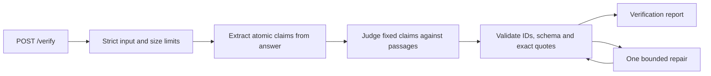

# Citation Grounding & Faithfulness Verifier

## Design intent

The service evaluates **faithfulness to the supplied passages**, not truth on the web. It keeps three concerns separate: which factual claims the answer makes, whether those claims are supported or refuted, and whether each returned quotation actually exists. Only the last concern can be guaranteed by deterministic string validation; semantic quality and extraction completeness remain measured properties.

The design follows four completed research dossiers: [grounding algorithms](research/grounding/README.md), [evaluation methods](research/evaluation/README.md), [structured APIs](research/structured-api/README.md), and the user-requested [Hermes-style Codex provider](research/codex-provider/README.md).

## Request path and boundaries

The optional optimized flow is shown below; the default minimal flow produces the complete claim report in one structured model call before the same validation gate.

Python 3.11+, FastAPI and Pydantic v2 provide a small typed service. One provider interface returns structured text and measured usage. The optional optimized path uses two logical calls: extraction sees only the answer, and verification sees the fixed extracted claims plus the original indexed passages. Extracted claims preserve negation, numbers, units, attribution, conditions, modality and scope. A quoted answer anchor must occur verbatim in the answer, but anchors are not a proof of full extraction coverage.

The judge returns stable claim IDs, not rewritten claim text. The service verifies exact ID coverage, rejects duplicates and reconstructs the public report from the original claims. One bad item invalidates the entire attempt. A failed model call never causes a claim to disappear from a successful report.

The public response retains the assignment's exact four claim fields and two citation fields. Offsets are omitted; this avoids a second coordinate system and model-generated offsets. Citation checks use the original Unicode strings without case, whitespace, punctuation or normalization repair. Boolean indices, empty/blank quotes and negative/out-of-range indices are invalid.

Multiple quotations can jointly support or refute one claim. A true quotation with irrelevant or incomplete evidence is still a semantic error. Unresolved equal-scope conflicting passages map to UNSUPPORTED with a conflict explanation and no citations. Explicitly different dates, versions, entities or conditions must first be distinguished. Missing evidence is never evidence of falsehood.

## Three implementations and a shared seam

| Implementation | End-to-end behavior | Oracle-claim behavior |
| --- | --- | --- |
| `heuristic` | Conservative sentence splitting; lexical evidence selection with numeric/negation heuristics | Same evidence classifier over the supplied claims |
| `minimal` | One short structured prompt returns the complete report; same deterministic output gate | One short prompt judges the fixed supplied claims |
| `optimized` | Answer-only decomposition, then refined evidence judgment; finite defect repair | The same refined judge, skipping extraction |

The heuristic is intentionally inexpensive, not a semantic guarantee. It has no access to gold labels or benchmark IDs. Minimal and optimized share the provider, model, output gate, transport retry policy and deadlines. Optimized's extra calls and repairs are counted as part of its cost and latency, not hidden as pure prompting gains.

The historical v1 held-out comparison did not show a clear overall optimized advantage, while minimal used less latency and fewer tokens. The final delivery therefore defaults to minimal and retains optimized as an explicit option; this is not a claim of statistically established accuracy superiority.

Both consumers use `Verifier.verify(VerifyRequest) -> VerificationRun` and `Verifier.verify_claims(context_passages, claims) -> VerificationRun`. The latter preserves claim identity/cardinality and is an internal evaluation seam, not a new HTTP endpoint. `VerificationRun` contains the report and operational statistics; only the report is returned by `/verify`.

The shared module `grounding.contracts` owns request/report types, exact citation validation, safe error categories, provider request/result types, usage statistics and protocols. Service implementations live in `grounding`; the independent `grounding_eval` package imports this public seam without sharing verdict logic or exposing gold labels to the verifier.

## Provider boundary

`StructuredProvider.generate(StructuredRequest) -> ProviderResult` makes exactly one attempt and returns one complete JSON text, usage completeness and returned model identity when known. It does not perform hidden retries, schema repair or factual judgment. All attempts share the verification operation's budget.

The OpenAI adapter uses one reusable HTTPX AsyncClient and Responses REST: separate system instructions and serialized user data, strict JSON Schema, `store:false`, bounded output, no tools, search, conversation state or background work. It checks completion status, refuses partial/refused output, and traverses typed `output` items rather than assuming a top-level SDK-only `output_text` property. Pydantic's local checks remain authoritative even when the provider accepts the schema.

The optional Codex subscription/quota provider is informed by Hermes Agent. It uses the official public Sign in with ChatGPT (SIWC) flow for local open-source tools: this app obtains its own grant. `codex_auth.py` handles authorization and protected local profiles; `codex_provider.py` handles inference. Hermes informs authentication/transport separation and serialized rotating-token refresh. The implementation uses no imported Codex/Hermes credentials, private backend routes or coding-agent subprocesses.

This adapter sends tool-free streamed Responses requests with `store:false`, `stream:true`, `instructions` and a user-data message. Unlike API-key requests, the preview route omits unsupported sampling and maximum-output-token parameters, and does not use a system-role message. Only a completed stream is success; stream bytes and operation time are locally bounded. When the terminal response contains an empty output array, completed output-item events can supply the content, subject to item identity/index consistency and the same strict final parser. Deltas or EOF alone never establish success. Missing media-type metadata still requires valid SSE framing and completion. Strict JSON Schema compatibility must be confirmed by the real adapter smoke test, and unsupported capability fails explicitly. Credentials live in a protected app-specific profile store outside the repository, validated through PKCE/state/nonce and JWKS-verified identity. Refreshes are serialized across processes. The CLI offers explicit login, status, model discovery and logout without exposing secrets. See [official registration](https://developers.openai.com/siwc/token-sharing-open-source/sign-in) and [preview limits](https://developers.openai.com/siwc/token-sharing-open-source/preview-limitations).

Both LLM variants share the same model, authentication profile, cancellation/attempt limits and validation path. Subscription usage is not assigned an invented per-token dollar price; missing provider usage remains unknown. A quota exhaustion error is terminal and does not imply the entire subscription is exhausted. An unusable provider fails explicitly rather than silently switching to another model or the heuristic.

For completed-item assembly, a paired reasoning item may omit its optional status; an explicit unfinished status still fails, and assistant messages must be completed. Once a terminal response is received, its validated usage and model metadata remain available even if subsequent local output assembly fails. Shared metadata parsing uses the same rules as ordinary response parsing and never estimates consumption from partial text.

## Reliability and diagnostics

Initial public limits: 1 MiB HTTP body, 32 passages, 16,000 characters per passage, 96,000 aggregate context characters, 12,000 answer characters and 64 extracted claims. Reject oversized inputs rather than truncate them. Blank answers return no claims without a provider call. Empty context still requires factual extraction, then each extracted fact is unsupported.

A default 60-second operation deadline includes queueing, decomposition, judgments, retry delays and repair. At most six provider attempts are permitted. A transient provider failure may be retried once per logical call within that shared cap; extraction and judgment each permit at most one schema/quote/ID repair. Codex failures after its SSE stream opens are terminal. An outer provider timeout is also terminal because the caller cannot determine whether inference was already consumed; the adapter's explicit retry decision survives the service error boundary. Refusals and incomplete responses are errors, not prompts to circumvent a refusal. All limits are explicit settings and are recorded for benchmark runs.

HTTP status and safe error codes follow the [verification specification](../openspec/changes/citation-grounding/specs/grounding-verification/spec.md). Invalid input is 422, oversized body 413, configuration/temporary availability 503, invalid/refused/incomplete results 502, operation timeout 504. Internal faults are 500. Provider error bodies and validation inputs are not exposed.

Local JSON diagnostics use an internally generated correlation ID and allowlisted stage, outcome, error code, elapsed milliseconds and counts. The implementation must make request start/end, provider attempt and validation/repair boundaries diagnosable while excluding payloads, quotes, credentials and raw exception text. Write failures are best-effort; a permanently blocked synchronous sink is explicitly outside any demonstrated timeout claim. Independent probes cover success, injected failure, secret non-disclosure and subsequent recovery.

## Evaluation design

The historical v1 dataset contains 32 fictional cases and remains at `datasets/legacy/main-v1.jsonl`. The second-round development pilot uses frozen licensed documentation, longer answers and explicit source/answer mappings. Its current status and actual population are in the [data card](../reports/eval-v2/data-card.md). Final v2 expansion, test selection and model measurements remain pending; `datasets/main.jsonl` has not yet switched from v1.

`grounding_eval.provenance` defines separate strict legacy and real-source types. Each real-source claim has a verified Unicode `[start,end)` answer anchor. A neighboring `*.manifest.json` binds dataset/schema/annotation versions, layout, source family, pinned URL/revision, raw and license hashes, and exact contiguous source slices. Unknown fields and invalid paths fail closed. Source metadata, gold verdicts and review records are evaluator-only data; end-to-end inference receives only the two public request fields.

Non-author annotation review first hides author judgments, then locks independent labels before comparison and adjudication. Related source versions and overlapping documents must stay in the same split. Byte-identical source and declared-family checks are mechanical safeguards; they do not prove semantic independence or freedom from pretraining contamination. AI review and pending human review are distinct.
Primary quality views are separate:

- **Oracle verification:** label macro F1, per-class confusion, false-support rate on all non-supported gold claims, non-supported judgment coverage, failure counts and evidence-set coverage on fixed gold claim lists.
- **End-to-end:** conservative strict text/registered-alias one-to-one coverage, joint text/label F1, evidence-set coverage and exact case success. Only whitespace is normalized; numbers, punctuation, case, operators, units and negation remain meaningful. Matching is verdict-blind. Misses, duplicates and extra claims hurt the score.
- **Integrity/operations:** literal citation validity, error categories, attempts, repair rate, median/p95 elapsed time, measured usage and unknown usage. A zero denominator is null, not perfect performance.

Gold quote coverage is an auditable conservative proxy, not an independent NLI verdict. Returning a different sufficient paraphrase or evidence span may be undercounted; unmatched output is retained for review. No fuzzy match silently changes the headline score. Operational errors retain their gold facts and requests in denominators. Source-family bootstrap intervals and paired deltas use a fixed seed. Paired records use `(case_id, repetition)`; all observations from one family are resampled together. Repeated-run analysis requires an explicit common selection and compatible frozen configurations. A small subset measured repeatedly does not become a larger independent test set.

The runner persists version fields, dataset/source snapshots, prompt/code fingerprints, settings, seeded job order, per-case records and summary in a new run directory. Model runs require an explicit total-attempt budget; conservative reservation precedes each job, and exhausted jobs remain NOT_RUN with complete denominators. It refuses accidental overwrite and validates saved population, artifacts and scoring fingerprints before replay. Old records are replayed in the isolated fixed original source; no compatibility bypass rewrites their hashes. New settings distinguish the requested output-token limit from the effective limit: OpenAI receives the parameter, while Codex records an unknown effective limit and explicitly marks the cap not applied. Legacy configurations retain their original bytes; their single `max_output_tokens` value describes a request, not proof of enforcement. `--split diagnostic` runs edge cases separately; `--split all` remains dev/test only. Development failures justify prompt revisions; held-out outputs are not used to add aliases or tune prompts. If live inference is unavailable, results say NOT_RUN. Offline scripted-provider tests never substitute for live quality, latency or cost measurements.

Optional `--stop-on-model-error` leaves later model jobs uncalled after the first failure while allowing heuristic work to continue; the triggering operation retains its bounded retry policy. Replay checks the stop against saved ordered outcomes and initialization failures. It verifies consistency, not authenticity of editable local artifacts. Historical configurations without this option keep their original policy.

A separate `grounding_eval.audit` CLI prepares anonymous alignment packets, validates complete claim partitions and locks judgments before revealing labels/evidence. Its hash locks detect inconsistent artifacts; they do not prove reviewer independence or semantic correctness. Merged, split, uncertain and scope-changed relations do not silently receive full credit. See the [audit policy](../reports/eval-v2/audit-policy.md); no final test audit result is claimed yet.

## Deliberate scope and residual risks

There is no vector store, external factual retrieval, database, UI, generic agent framework or telemetry service. These would add failure surfaces without satisfying this assignment better. The original synthetic benchmark cannot establish production accuracy or universal injection resistance; longer public documents and AI-reviewed labels alone cannot establish that either. Exact citation guards cannot prove reasoning or extraction faithfulness. Those limits remain visible in the README even if all engineering tests pass.
